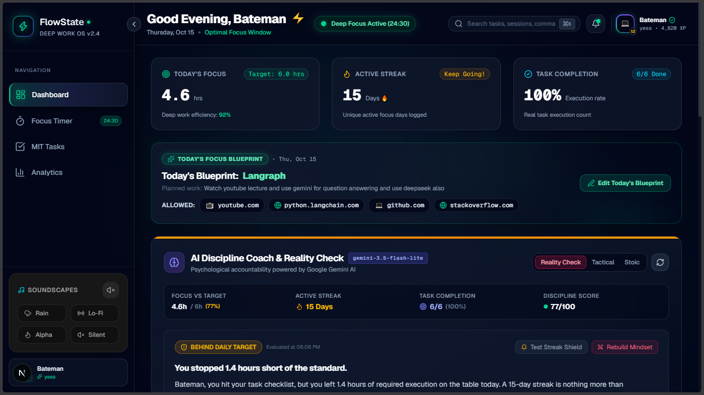
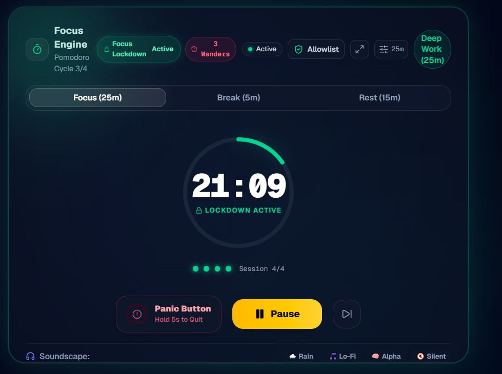
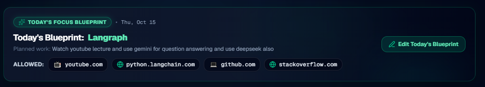
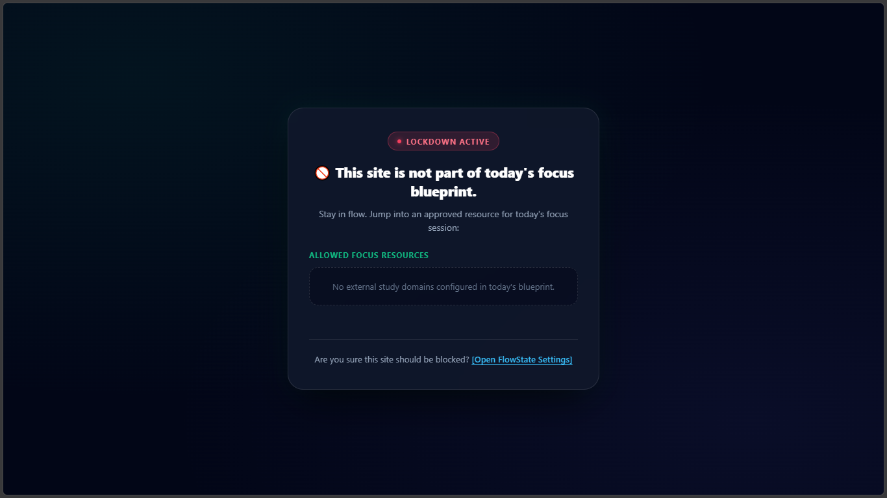
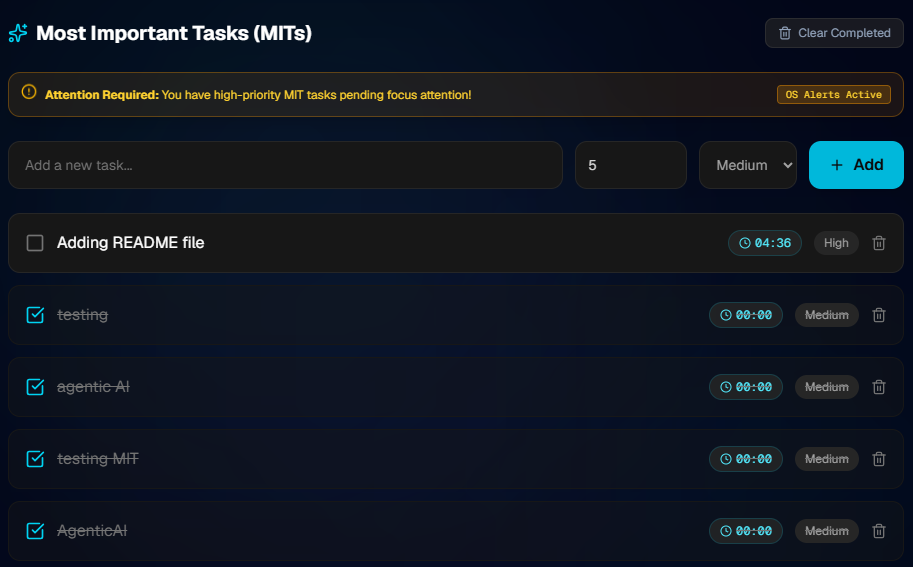
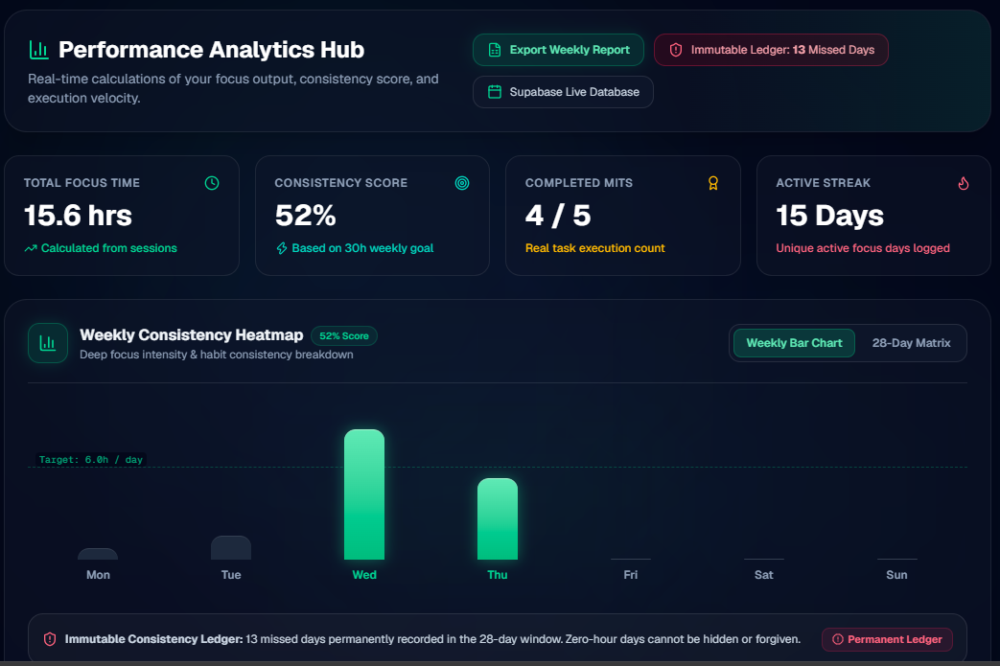

# FlowState

> **Deep Work & Productivity Dashboard**  
> A system-driven discipline app that replaces fleeting motivation with an enforceable system: Pomodoro focus engine, brutal AI accountability, and strict browser lockdown.

[](https://nextjs.org/)
[](https://www.typescriptlang.org/)
[](https://tailwindcss.com/)
[](https://supabase.com/)
[](https://ai.google.dev/)
[](LICENSE)



> [!WARNING]
> **FlowState requires BOTH the web app AND the Chrome extension for full functionality.** The web app coordinates timers, tasks, and coaching, while the Manifest V3 Chrome extension enforces network-level distraction blocking.

---

## ⚡ What is FlowState?

Most productivity applications rely on willpower. When motivation inevitably dips, opening social media, infinite scrolls, or unrelated browser tabs requires zero friction. The outcome is fragmented attention, unfinished goals, and broken consistency streaks.

**FlowState replaces motivation with an enforceable system.** Instead of hoping you will stay on track, FlowState locks your digital environment. Before each deep work block, you construct a Daily Focus Blueprint defining your primary objective and allowed domains. Once initiated, distracting websites and YouTube Shorts feeds are immediately intercepted at the network level.

Paired with a Google Gemini-powered AI Discipline Coach that delivers unapologetic reality checks, an immutable consistency ledger, and ambient soundscapes, FlowState converts daily intention into uninterrupted execution.

---

## ✨ Features

### ⏱️ Focus Engine
- **Customizable Pomodoro Timer**: 25/5/15 intervals or custom focus durations with soundscapes (Rain, Lo-Fi, Alpha waves).
- **Most Important Tasks (MITs)**: Task countdown timers with persistent state preserved across browser refreshes and restarts.
- **Friction-Based Panic Button**: 5-second deliberate hold required to abort a session, discouraging impulsive quits.
- **Tab-Away Monitoring**: Optional toast alerts whenever attention drifts away from the active focus window.

### 🤖 AI Discipline Coach
- **Gemini-Powered Accountability**: Brutal, context-aware reality checks analyzing your excuses, productivity logs, and streaks.
- **Daily Focus Blueprint Wizard**: 3-step pre-session setup with AI suggestions to break down complex goals into actionable targets.

### 🛡️ Browser Lockdown & Allowlist
- **Manifest V3 DeclarativeNetRequest**: High-performance domain blocking without browser slowdown.
- **Granular YouTube Shorts Blocking**: High-priority rule targeting `youtube.com/shorts` while preserving access to educational tutorials.
- **Auto-Redirect Interception**: Blocked tabs display a clean lock screen and automatically route you back to FlowState in 3 seconds.

### 📊 Consistency & Analytics
- **Immutable Consistency Ledger**: Uncompromising record where missed sessions and broken streaks are permanently logged.
- **Activity Heatmap**: Visual weekly consistency tracker mapping completed deep work hours.

---

## 📸 Screenshots

| Focus Dashboard | Pomodoro Focus Engine |
| :---: | :---: |
|  <br /> *Unified cockpit with active tasks & coach* |  <br /> *High-contrast focus timer with soundscapes* |
| **Focus Blueprint Setup** | **Hard Distraction Blocker** |
|  <br /> *3-step wizard with smart domain allowlists* |  <br /> *Immediate network-level interception screen* |
| **Most Important Tasks (MITs)** | **Consistency & Heatmap Analytics** |
|  <br /> *Task countdown timers with persistent state* |  <br /> *Weekly focus tracking and consistency ledger* |


---

## 🔄 How It Works

```
┌────────────────────────┐      ┌────────────────────────┐      ┌────────────────────────┐      ┌────────────────────────┐
│  1. Daily Blueprint    │ ───► │   2. Deep Work Block   │ ───► │  3. Hard Enforced Lock │ ───► │   4. AI Reality Check  │
│  Define MIT & allowlist│      │  Timer + Soundscapes   │      │ Extension blocks tabs  │      │  Review & ledger log   │
└────────────────────────┘      └────────────────────────┘      └────────────────────────┘      └────────────────────────┘
```

1. **Blueprint**: Set today's primary objective, estimate required intervals, and designate allowed URLs.
2. **Focus**: Initiate the Pomodoro chamber with ambient audio and synchronized MIT timers.
3. **Blocking**: The Chrome companion extension activates dynamic firewall rules for distracting domains.
4. **Accountability**: Complete the session or face the AI Coach; progress is immutably committed to Supabase.

---

## 🛠️ Tech Stack

| Layer | Technology | Description |
| :--- | :--- | :--- |
| **Framework** | Next.js 14 (App Router) | Server components, API routes, and fast rendering |
| **Language** | TypeScript | Strict type safety across client and server modules |
| **Styling** | Tailwind CSS | Utility-first responsive styling and high-contrast dark aesthetic |
| **Animations** | Framer Motion | Smooth UI transitions, modals, and timer feedback |
| **Database & Auth**| Supabase (PostgreSQL) | Realtime sync, row-level security, and audit ledger |
| **AI Engine** | Google Gemini AI | Contextual discipline coaching and blueprint suggestions |
| **Extension** | Chrome Extensions (Manifest V3) | `declarativeNetRequest` dynamic blocking rules & postMessage bridge |

---

## 🚀 Quick Start

### Prerequisites
- [Node.js](https://nodejs.org/) (v18.17+) & [Git](https://git-scm.com/)
- Free [Supabase](https://supabase.com/) project
- [Google Gemini API Key](https://aistudio.google.com/)

### 1. Clone & Configure
```bash
git clone https://github.com/your-username/flowstate.git
cd flowstate
npm install
cp .env.example .env.local
```

### 2. Supabase Schema Setup
Execute the following SQL in your Supabase project's **SQL Editor**:

```sql
-- Focus Blueprints Table
CREATE TABLE IF NOT EXISTS public.focus_blueprints (
    id UUID PRIMARY KEY DEFAULT gen_random_uuid(),
    user_id UUID REFERENCES auth.users(id) ON DELETE CASCADE,
    goal TEXT NOT NULL,
    planned_work TEXT,
    allowlist TEXT[] NOT NULL DEFAULT '{}'::TEXT[],
    session_duration INTEGER NOT NULL DEFAULT 25,
    created_at TIMESTAMPTZ NOT NULL DEFAULT timezone('utc'::text, now())
);

-- MIT Tasks Table with countdown persistence
CREATE TABLE IF NOT EXISTS public.tasks (
    id UUID PRIMARY KEY DEFAULT gen_random_uuid(),
    user_id UUID REFERENCES auth.users(id) ON DELETE CASCADE,
    title TEXT NOT NULL,
    priority TEXT DEFAULT 'Medium',
    category TEXT DEFAULT 'Work',
    completed BOOLEAN NOT NULL DEFAULT FALSE,
    duration TEXT DEFAULT '25m',
    remaining_seconds INTEGER DEFAULT NULL,
    created_at TIMESTAMPTZ NOT NULL DEFAULT timezone('utc'::text, now())
);

-- Enable Row Level Security (RLS)
ALTER TABLE public.focus_blueprints ENABLE ROW LEVEL SECURITY;
ALTER TABLE public.tasks ENABLE ROW LEVEL SECURITY;

CREATE POLICY "Allow read/write access for focus_blueprints" ON public.focus_blueprints FOR ALL USING (true) WITH CHECK (true);
CREATE POLICY "Allow read/write access for tasks" ON public.tasks FOR ALL USING (true) WITH CHECK (true);
```

### 3. Run Locally
```bash
npm run dev
```
Open [http://localhost:3000](http://localhost:3000) in Google Chrome.

---

## 🧩 Chrome Extension Setup

The companion extension enforces distraction blocking while your focus session is active.

1. Open Google Chrome and navigate to `chrome://extensions`.
2. Enable **Developer mode** using the toggle switch in the upper-right corner.
3. Click the **Load unpacked** button in the upper-left corner.
4. Select the `extension` folder inside your project directory (`flowstate/extension`).
5. Confirm **FlowState Blocker** appears with its service worker active. Refresh `http://localhost:3000` to connect the web app bridge.

> [!TIP]
> Click the blue **service worker** link on the extension card in `chrome://extensions` to inspect live blocking rule installations.

---

## ⚙️ Configuration

| Variable | Required | Description |
| :--- | :---: | :--- |
| `NEXT_PUBLIC_APP_URL` | Yes | Base URL of the web app (e.g., `http://localhost:3000`) |
| `NEXT_PUBLIC_SUPABASE_URL` | Yes | Supabase project URL (`https://your-project.supabase.co`) |
| `NEXT_PUBLIC_SUPABASE_ANON_KEY` | Yes | Supabase public anonymous API key |
| `GEMINI_API_KEY` | Yes | Google Gemini API key used by the backend AI Coach route |
| `NEXT_PUBLIC_GEMINI_API_KEY` | No | Optional client-side Gemini fallback key |

---

## 🤖 AI Coach Setup

1. Obtain a Gemini API key from [Google AI Studio](https://aistudio.google.com/).
2. Add the key to `.env.local` as `GEMINI_API_KEY`.
3. *(User-provided keys)*: Users can also input their personal Gemini API key directly through the in-app Profile Settings dialog to avoid shared quota limits.

---

## 📂 Project Structure

```text
flowstate/
├── app/                              # Next.js App Router
│   ├── api/blueprint-suggestions/    # AI task decomposition endpoint
│   ├── api/coach/                    # Gemini AI discipline coach endpoint
│   ├── globals.css                   # Tailwind styles
│   └── page.tsx                      # Main dashboard page
├── components/                       # UI components
│   ├── AIDisciplineCoach.tsx         # AI Coach drawer and reality checks
│   ├── FocusBlueprintModal.tsx       # 3-step setup wizard with domain allowlist
│   ├── PomodoroTimer.tsx             # Focus engine with soundscape player
│   ├── TaskList.tsx                  # MIT tasks with countdown timers
│   └── PanicButton.tsx               # 5-second hold friction abort button
├── extension/                        # Manifest V3 Chrome Companion Extension
│   ├── background.js                 # DeclarativeNetRequest dynamic rule manager
│   ├── blocked.html                  # Interception landing page
│   ├── content.js                    # postMessage bridge between web app & browser
│   └── manifest.json                 # Extension manifest
├── lib/                              # Supabase client and helper utilities
├── screenshots/                      # Project screenshot previews
└── supabase/migrations/              # SQL migrations
```

---

## 🗺️ Roadmap

- [x] Pomodoro focus engine with custom intervals
- [x] Chrome MV3 allowlist & domain blocking engine
- [x] AI Discipline Coach integration via Google Gemini
- [x] MIT task countdown timer with offline persistence
- [ ] Multi-device blocking sync via native desktop daemon
- [ ] Team accountability pacts with shared consistency ledgers
- [ ] Spotify / Apple Music focus playlist integration

---

## 🤝 Contributing

Contributions are welcome!
1. Fork the repository & create your branch (`git checkout -b feature/amazing-feature`).
2. Commit your changes (`git commit -m 'Add amazing feature'`).
3. Push to the branch (`git push origin feature/amazing-feature`).
4. Open a Pull Request.

---

## 📄 License

This project is licensed under the [MIT License](LICENSE).

---

